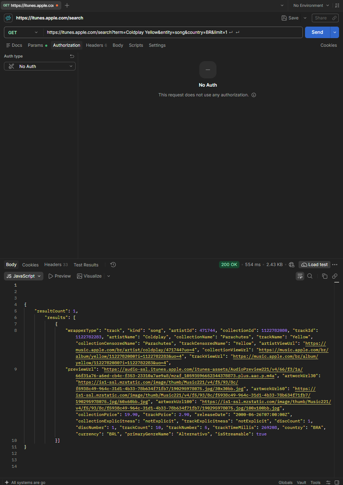
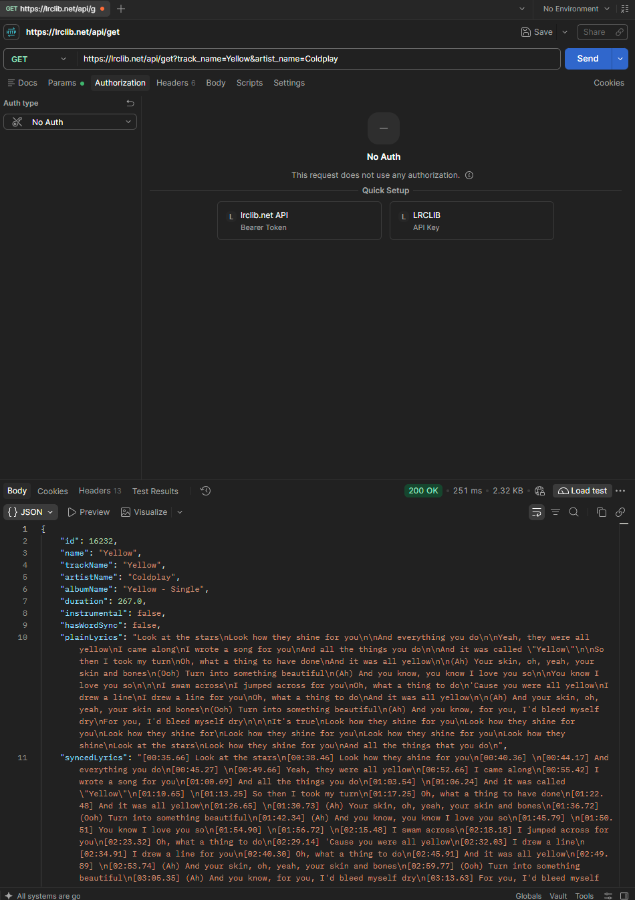
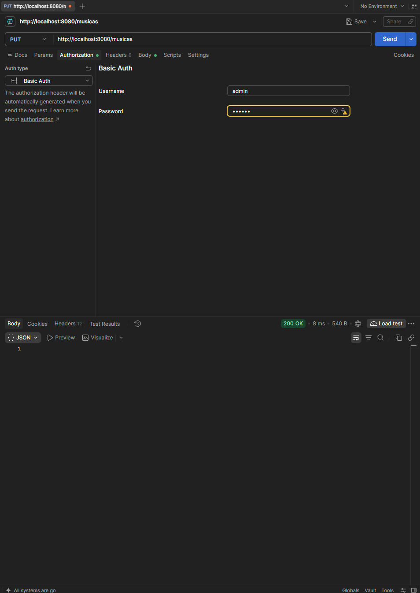
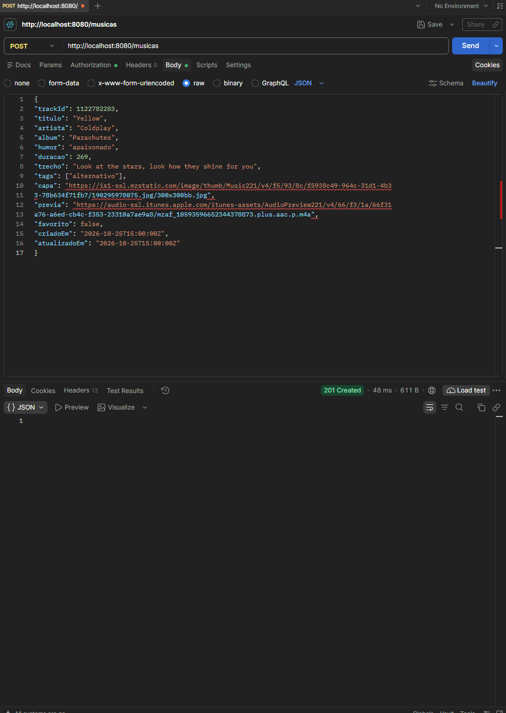
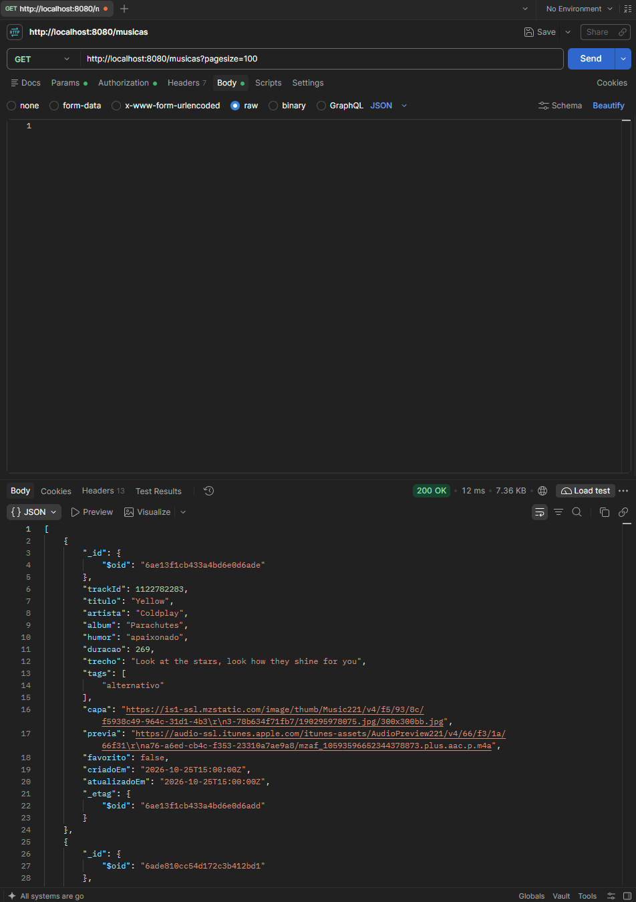
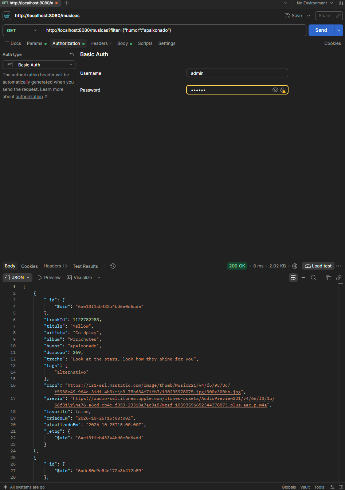
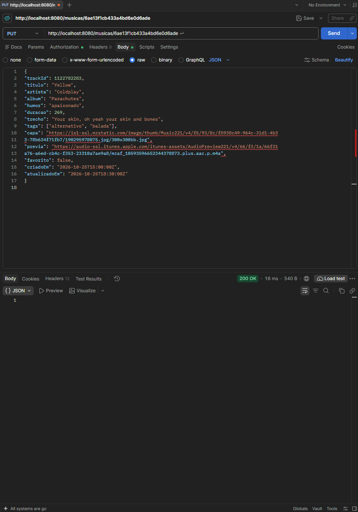
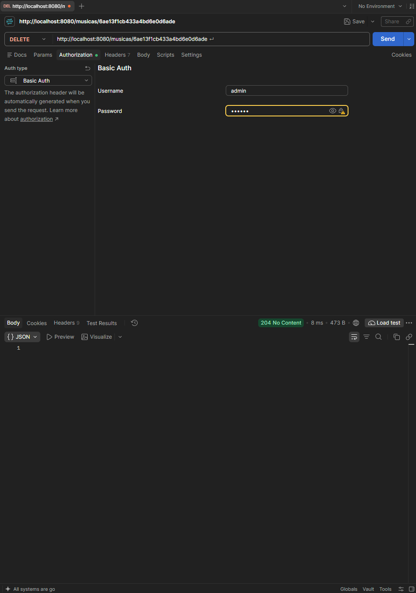
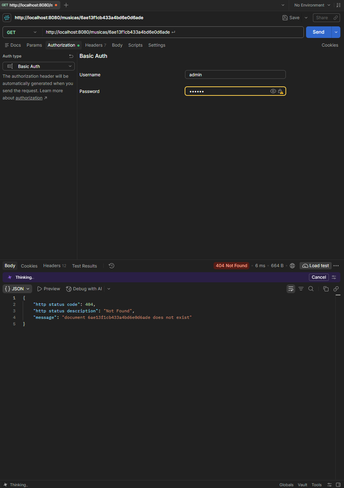
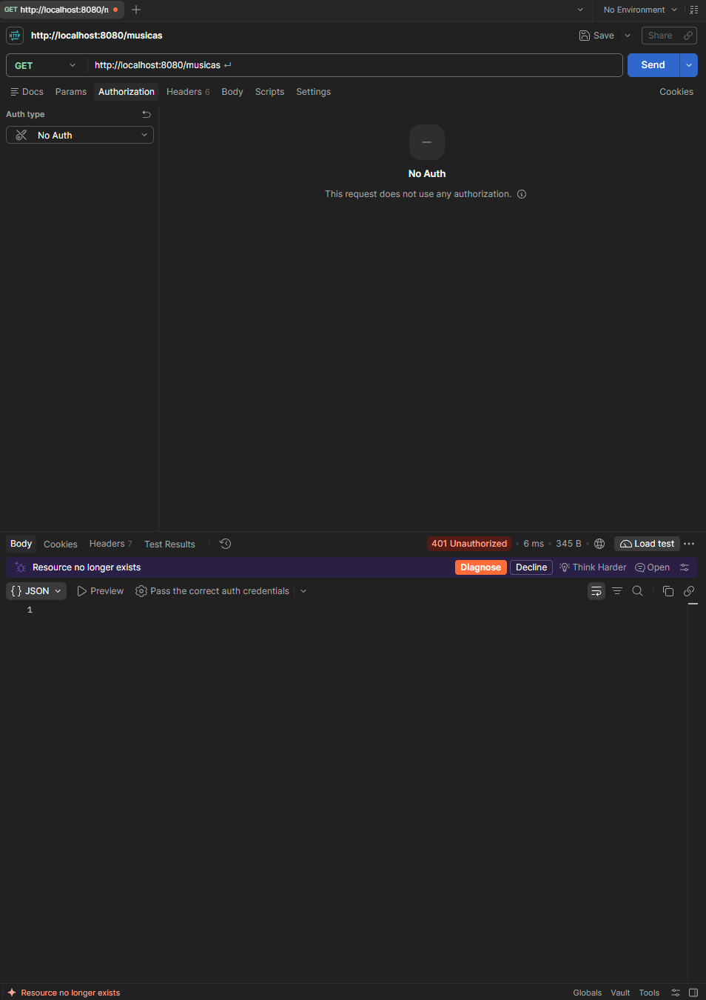

# MoodTune

Trabalho da disciplina de Banco de Dados (Engenharia de Software, UNC) — professor Luis Claudio.

O MoodTune é um site onde a pessoa escolhe **como está se sentindo** e recebe uma música com um
**trecho da letra destacado**, junto com a capa do álbum e uma prévia de 30 segundos.

## Equipe

| Integrante | Parte | 
| ----- | ----- | 
| Luiz | Dados: modelagem e banco no Docker | 
| Henrique | API: requisições HTTP, coleção do Postman e script de importação | 
| Gula | Interface: frontend, painel e gráficos | 

## Como rodar

Pré-requisito: Docker.

**1.** Suba tudo (banco, API e site):

```bash
docker compose up -d
```

**2.** Abra o site em **http://localhost:3000**. Ele é servido por um container nginx do próprio
compose, então não precisa instalar mais nada. Não adianta abrir o `frontend/index.html` direto
pelo explorador (`file://`): nesse modo o navegador bloqueia a leitura do `musicas.json`.

**3.** Se o banco estiver vazio, clique em **Importar músicas**, no fim da página. O banco sobe vazio, e esse botão busca as músicas no iTunes
e as letras na LRCLIB e grava tudo no MongoDB — leva cerca de um minuto e só precisa ser feito uma
vez. Depois disso o site lê sempre do banco.

Se a importação parar no meio (as APIs públicas às vezes respondem "estou ocupada"), é só clicar
de novo: o que já entrou é pulado, nada duplica.

Para conferir se subiu:

```
docker compose ps                                         # os 3 serviços devem estar "running"
curl -u admin:secret "http://localhost:8080/musicas?pagesize=100"

```

### Parar e apagar o ambiente

```
docker compose logs -f restheart   # acompanhar os erros do RESTHeart
docker compose stop                # pausar sem perder nada
docker compose down                # parar e remover os containers (os dados continuam)
docker compose down -v             # parar e APAGAR os dados do volume

```

Os dados sobrevivem ao `docker compose down` porque ficam no volume nomeado `dados-mongo`.
Só o `-v` apaga de verdade — e aí é preciso rodar a importação de novo.

## Arquitetura

```
APIs externas (só GET, só na importação)         Banco                 Site
┌──────────────────────┐
│ iTunes Search API    │  metadados, capa, prévia
│ LRCLIB               │  letra (só o trecho)      ──►  MongoDB   ──►  frontend (nginx)
└──────────────────────┘     frontend/importar.js      + RESTHeart     :3000, lê e grava
                                                        :8080           só no banco
```

As duas APIs externas não têm id em comum. A ligação entre elas é feita por **artista + título**,
usando a **duração em segundos** como confirmação: primeiro perguntamos ao iTunes, depois usamos os
nomes que ele devolve para pedir a letra à LRCLIB.

O site **não chama as APIs externas** a cada clique: ele lê e grava apenas no banco.

### Containers

| Serviço | Imagem | Porta | Para quê |
|---|---|---|---|
| `mongodb` | `mongo:7` | 27017 | guarda os documentos, no volume `dados-mongo` |
| `restheart` | `softinstigate/restheart:8` | 8080 | a API HTTP em cima do MongoDB |
| `frontend` | `nginx:alpine` | 3000 | serve a pasta `frontend/` |

O `frontend` monta a pasta `./frontend` dentro do nginx (somente leitura). Por isso qualquer
alteração no HTML, CSS ou JS aparece só recarregando a página, sem recriar o container. Quem chama
o RESTHeart é o navegador, e não o nginx, por isso o `app.js` continua usando
`http://localhost:8080`.

### Banco

MongoDB 7 + RESTHeart 8, ambos em Docker (`docker-compose.yml`), com volume nomeado `dados-mongo`
para os dados não sumirem quando o container é recriado. Nada em nuvem.

* API: `http://localhost:8080/musicas`

* Autenticação: Basic `admin` / `secret` (padrão do RESTHeart, aceitável porque só roda local)

#### Especificações Técnicas e Persistência NoSQL (Luiz)

* **SGBD & Gateway:** MongoDB 7.0 integrado ao RESTHeart 8 via containerização isolada no Docker Compose.

* **Persistência de Dados:** Volume Docker nomeado `dados-mongo` mapeado para `/data/db`, garantindo a retenção dos documentos NoSQL mesmo com reinicializações do ambiente (`docker compose down`).

* **Conexão Direta para Inspeção (GUI/Compass):** `mongodb://localhost:27017` — o MongoDB do compose não tem usuário próprio (quem pede senha é o RESTHeart). Os documentos ficam no banco `restheart`, coleção `musicas`.

* **Estratégia NoSQL:** Estrutura *schema-less* otimizada para consultas diretas em documento único (Single-Document Reads) via HTTP, eliminando a necessidade de operações custosas de `JOIN`.

## Modelo do documento

```
{
  "trackId": 1122782283,
  "titulo": "Yellow",
  "artista": "Coldplay",
  "album": "Parachutes",
  "humor": "apaixonado",
  "duracao": 269,
  "trecho": "Look at the stars, look how they shine for you",
  "tags": ["alternativo"],
  "capa": "https://.../300x300bb.jpg",
  "previa": "https://.../preview.m4a",
  "favorito": false,
  "criadoEm": "2026-10-25T19:11:59.496Z",
  "atualizadoEm": "2026-10-25T19:11:59.496Z"
}

```

* **Número:** `duracao` (segundos) — **Data:** `criadoEm` / `atualizadoEm` — **Lista embutida:** `tags`

* **Campos criados pelo grupo:** `humor`, `trecho`, `favorito`, `atualizadoEm`

* `titulo`, `artista`, `album` e `duracao` vêm das APIs, não são digitados à mão.

**Embutido x referenciado.** As `tags` ficam **embutidas** no documento porque são poucas, mudam
junto com a música e nunca são consultadas sozinhas — separá-las em outra coleção só criaria uma
busca a mais para montar a tela.

Já a letra é **referenciada**: ela continua na LRCLIB e nós guardamos apenas o `trecho` destacado.
O `trackId` é o id da música no iTunes e cumpre o mesmo papel para os metadados — em vez de copiar
o registro inteiro da API para dentro do banco, guardamos a chave que permite voltar lá quando
precisar. É o que mantém o documento pequeno e evita duplicar dado que não é nosso.

O `_id` volta no formato `{ "$oid": "..." }`.

## Endpoints

| Ação | Método e URL | Status | 
| ----- | ----- | ----- | 
| Criar coleção | `PUT /musicas` | 201 (200 se já existia) | 
| Inserir | `POST /musicas` | 201, id no cabeçalho `Location` | 
| Listar | `GET /musicas?pagesize=100` | 200 | 
| Buscar uma | `GET /musicas/{id}` | 200 / 404 | 
| Filtrar por humor | `GET /musicas?filter={"humor":"feliz"}` | 200 | 
| Substituir | `PUT /musicas/{id}` | 200 | 
| Alterar campos | `PATCH /musicas/{id}` | 200 | 
| Excluir | `DELETE /musicas/{id}` | 204 | 
| Sem autenticação | qualquer uma | 401 | 

## Script de importação

`frontend/importar.js` — roda no navegador, pelo botão **Importar músicas**. Sem biblioteca
nenhuma, só o `fetch` do próprio navegador.

Ele lê a lista do grupo em `frontend/musicas.json` (artista, título, humor e, opcionalmente, um
trecho escolhido à mão) e, para cada música: consulta o iTunes, consulta a LRCLIB, monta o documento
e faz `POST` no banco.

Roda no navegador de propósito: assim quem for corrigir o trabalho precisa apenas do Docker, sem
instalar mais nada. As três APIs liberam CORS, então o navegador consegue chamar as duas externas
e o RESTHeart direto.

Decisões que vale explicar:

- **Não para quando uma música falha.** Cada música roda dentro de um `try/catch`; o erro é contado
  e listado no resumo do final, e o script segue para a próxima.
- **Não duplica.** Antes de gravar, pergunta ao banco se já existe música com o mesmo título e
  artista. A consulta ao iTunes vem **antes** dessa checagem de propósito: o documento é gravado com
  o nome que o iTunes devolve (`Pais Tropical` da nossa lista vira `País Tropical`), então comparar
  usando o nome da lista não acharia o que já está lá e duplicaria tudo a cada execução.
- **Retentativa.** A LRCLIB responde 503 ("server is busy") quando recebe muitas consultas seguidas.
  O script tenta de novo até 5 vezes, dobrando a espera (1s, 2s, 4s...). 404 não é retentado, porque
  ali a resposta é definitiva.

* **Escolha do resultado no iTunes.** A busca devolve várias versões; a escolha pesa **artista
  (x10) e título**, e desconta versões ao vivo / demo / cover. Sem o peso do artista, "Creep" do
  Stone Temple Pilots empatava com o do Radiohead, e um cover do Boyce Avenue ganhava do Green Day.
  Resultado cujo título não bate com o pedido é descartado: se nenhum bater, a música entra como
  falha no resumo em vez de gravar outra música no lugar.

* **Escolha do trecho.** A linha que mais se repete na letra costuma ser o refrão. Linhas com
  palavras muito repetidas (`Ba-de-ya, de-ya, de-ya`) são descartadas antes, senão o destaque do
  site cairia em onomatopeia. Um `trecho` escrito na lista sempre tem prioridade sobre o automático.

Estado atual: **35 músicas** no banco, distribuídas em 6 humores (feliz, triste, apaixonado,
nostálgico, animado, calmo).

Três músicas ficaram gravadas em versão alternativa — `Good Riddance [Live]`, `Back To Black
(Original Demo)` e `Garota de Ipanema (Live In San Francisco, 2003)`. Não é falha do script: a
versão de estúdio delas **não existe no catálogo do iTunes Brasil** (conferimos buscando 50
resultados). O que está no banco é o melhor que a API oferece, e é dado real dela.

## Como o site funciona

Tudo o que a tela faz passa pelas funções de `frontend/app.js`, que são as únicas que falam com o
banco. Cada uma devolve o **status HTTP** da resposta, e a tela mostra esse número na mensagem de
sucesso ou de erro (ex.: `"Yellow" foi atualizada (PUT 200).`).

| Na tela | Função em `app.js` | Requisição |
|---|---|---|
| Abrir a página / recarregar a lista | `listarMusicas` | `GET /musicas?pagesize=100` |
| Clicar em um humor ou em **Sortear outra** | `listarPorHumor` | `GET /musicas?filter={"humor":"..."}` |
| **＋ Nova música** e salvar | `criarMusica` | `POST /musicas` |
| **Editar** e salvar | `substituirMusica` | `PUT /musicas/{id}` |
| **♡ Favoritar** | `favoritarMusica` | `PATCH /musicas/{id}` |
| **Excluir** (pede confirmação antes) | `excluirMusica` | `DELETE /musicas/{id}` |

* **Escolha da música.** Ao clicar em um humor, o site faz o `GET` filtrado, sorteia uma das
  músicas com `Math.random()` (evitando repetir a que já está na tela) e mostra capa, título,
  artista, o **trecho destacado** e a prévia de 30 s tocando.
* **Busca e filtros.** A caixa de busca procura no título e no artista, sem diferenciar maiúsculas
  e acentos; o filtro de gênero usa as `tags`; o humor escolhido também filtra a lista. **Limpar
  filtros** volta tudo ao início.
* **Formulário.** Valida antes de enviar: título, artista, humor e trecho obrigatórios; duração
  inteira e maior que zero; capa e prévia, se preenchidas, precisam começar com `http://` ou
  `https://`. Na edição, os campos que não aparecem no formulário (`trackId`, `album`,
  `favorito`, `criadoEm`) são mantidos, porque o `PUT` substitui o documento inteiro.
* **Depois de cada POST, PUT, PATCH e DELETE** a lista é recarregada do banco, e a página dispara o
  evento `musicas-carregadas` com a lista atual — é nele que o painel vai se pendurar para se
  atualizar sozinho.
* **Erros.** O `fetch` não cai no `catch` em 404 ou 500, então `requisitar()` confere `res.ok` e
  lança um erro com o status. Se o banco estiver fora do ar, a mensagem pergunta se o
  `docker compose` está rodando.

## Coleção do Postman

`postman/colecao.json` — 12 requisições numeradas, na mesma ordem do fluxo do projeto:

* **01 e 02** — as duas APIs externas (iTunes e LRCLIB), que é de onde os dados vêm. Usam `noauth`,
  para não mandar a senha do nosso banco para serviços de terceiros.

* **03 a 12** — o CRUD completo no banco, incluindo o 404 depois do DELETE e o 401 sem autenticação.

Rodam em ordem: a 04 (POST) lê o id do cabeçalho `Location` e guarda na variável `idMusica`, e as
seguintes reutilizam esse id sozinhas — não é preciso colar id nenhum à mão.

Importe no Postman, ou rode pela linha de comando:

```
npx newman run postman/colecao.json

```

Última execução: **12 requisições, 22 asserções, 0 falhas.**

## Evidências de teste

Prints das requisições rodando de verdade, com o **status HTTP à mostra**. Os arquivos estão em
`docs/prints/`, e a ordem abaixo é a mesma do fluxo do projeto.

### As duas APIs externas

Nas duas o *Auth type* está em **No Auth**: são serviços de terceiros, não faz sentido mandar a
senha do nosso banco para eles.

**iTunes Search API** — `GET https://itunes.apple.com/search?term=Coldplay Yellow&entity=song&country=BR&limit=1`



Status **200**. É daqui que saem `titulo`, `artista`, `album`, `capa` (`artworkUrl100`) e `previa`
(`previewUrl`). A duração vem em milissegundos — `trackTimeMillis: 269208` vira os 269 segundos que
gravamos. O `country=BR` não é enfeite: sem ele a busca cai no catálogo americano e parte do
repertório brasileiro não aparece.

**LRCLIB** — `GET https://lrclib.net/api/get?track_name=Yellow&artist_name=Coldplay`



Status **200**. As duas APIs não têm nenhum id em comum, então a ligação é feita por **artista +
título** — é o que esta requisição usa. Repare no `albumName`: a LRCLIB devolveu "Yellow - Single",
enquanto o iTunes tinha dito "Parachutes". São gravações diferentes da mesma música, e é por isso
que o `importar.js` e a coleção do Postman mandam também `&album_name=` e `&duration=`: a duração
que o iTunes devolveu confirma qual versão é a certa. Sem esse acerto, a letra poderia vir de uma
gravação com outro tempo e outro arranjo.

Do `plainLyrics` sai apenas o `trecho` que o site destaca; a letra inteira continua na LRCLIB.

### O CRUD no banco

**Criar a coleção** — `PUT /musicas`



Status **200** porque a coleção já existia; na primeira execução o RESTHeart devolve **201**.

**Inserir** — `POST /musicas`



Status **201 Created**. O corpo da resposta vem vazio de propósito: o id do documento novo volta no
cabeçalho `Location`, na aba *Headers*. É de lá que sai o `6ae13f1cb433a4bd6e0d6ade` usado em todas
as requisições seguintes.

**Listar** — `GET /musicas?pagesize=100`



Status **200**. Repare no `_id` no formato `{ "$oid": "..." }` — é assim que o RESTHeart devolve o
ObjectId do Mongo, e é por isso que o site lê `musica._id.$oid`, não `musica._id`.

**Filtrar por humor** — `GET /musicas?filter={"humor":"apaixonado"}`



Status **200**, e só as músicas daquele humor. É exatamente esta requisição que o site dispara
quando a pessoa escolhe como está se sentindo.

**Substituir** — `PUT /musicas/{id}`



Status **200**. O corpo traz o documento **inteiro**, porque o PUT substitui o que estava lá: campo
que não for enviado some. Neste print o `trecho` mudou para "Your skin, oh yeah your skin and bones"
e o `atualizadoEm` acompanhou a alteração.

**Excluir** — `DELETE /musicas/{id}`



Status **204 No Content**. Corpo vazio aqui é o resultado certo, não falta de resposta.

### Os erros que o banco devolve

**Documento que não existe** — `GET /musicas/{id}` logo depois do DELETE



Status **404**, com `"message": "document 6ae13f1cb433a4bd6e0d6ade does not exist"`. É o mesmo id do
print anterior: os dois juntos provam que a exclusão aconteceu de verdade, e não só que o servidor
respondeu sem reclamar.

**Sem autenticação** — mesma URL, com o *Auth type* em *No Auth*



Status **401 Unauthorized**. Vale lembrar que o `fetch` do navegador **não** cai no `catch` em 401,
404 ou 500 — ele só falha se a conexão cair. Por isso o `app.js` confere o `res.ok` de toda
resposta antes de usar os dados.

## Estrutura do repositório

```
Trabalho_BD_III_MoodTune/
├── docker-compose.yml       MongoDB + RESTHeart + nginx (site)
├── frontend/
│   ├── index.html           página do site
│   ├── style.css            estilos, com tema claro e escuro
│   ├── theme.js             alternância de tema (interface)
│   ├── app.js               as requisições HTTP ao banco (API)
│   ├── tela.js              liga a tela às requisições: humores, lista, busca, formulário
│   ├── importar.js          GET nas APIs externas + POST no banco (API)
│   └── musicas.json         lista do grupo (artista, título, humor)
├── docs/prints/             prints dos testes (evidências)
├── postman/colecao.json     coleção exportada, com os testes
└── README.md
```

É exatamente a estrutura pedida no enunciado — `importar.js` e `musicas.json` são arquivos do
frontend, não uma pasta nova.

**Por que quatro arquivos `.js` e não um só.** Cada um tem uma responsabilidade, e a divisão
acompanha quem fez o quê:

| Arquivo | O que faz | De quem |
|---|---|---|
| `theme.js` | alterna tema claro/escuro e lembra a escolha | Interface (Gula) |
| `app.js` | as requisições HTTP ao banco: os cinco métodos | API (Henrique) |
| `tela.js` | desenha a lista, sorteia pelo humor, abre o formulário e mostra as mensagens | API + Interface |
| `importar.js` | busca nas APIs externas e popula a coleção | API (Henrique) |

Juntar tudo num arquivo só funcionaria, mas atrapalharia: ficaria um arquivo longo misturando
assuntos, cada alteração de um integrante esbarraria na do outro no Git, e seria mais difícil
explicar na apresentação. Separar por responsabilidade é o normal, e nesta quantidade não traz
custo nenhum.

A única regra a respeitar é a **ordem no `index.html`**: `app.js`, depois `tela.js`, depois
`importar.js`. A tela usa as funções de `app.js`, e a importação usa o `BANCO` e os `CABECALHOS`
de `app.js` e chama `carregarMusicas()` de `tela.js` quando termina.

## Situação de cada requisito

**1. Modelagem NoSQL** — 1,5 ponto

* [x] 1 coleção (`musicas`) com 35 documentos importados das APIs (mínimo era 30)

* [x] 6+ campos, com 1 número (`duracao`), 1 data (`criadoEm`) e 1 lista embutida (`tags`)

* [x] Campos criados pelo grupo: `humor`, `trecho`, `favorito`, `atualizadoEm`

* [x] Exemplo de documento no README, com a justificativa de embutido x referenciado

**2. Métodos HTTP** — 2,5 pontos

* [x] GET nas APIs de origem para importar

* [x] POST gravando cada documento no banco

* [x] GET no banco: listar todos e buscar um pelo id

* [x] PUT substituindo o documento inteiro

* [x] PATCH alterando um único campo (`favorito`)

* [x] DELETE excluindo o documento

* [x] Coleção do Postman exportada com todas as requisições acima

* [x] Confirmação antes de excluir

**3. Frontend** — 2,0 pontos

* [x] Listagem com busca por texto e filtros por humor e por gênero

* [x] Formulário de criar/editar com validação

* [x] Mensagens de carregamento, sucesso e erro, mostrando o status HTTP

* [x] Layout que funcione no celular — verificado em 390, 768 e 1440 px, sem rolagem horizontal

**4. Geração de informação (painel)** — 2,0 pontos (Gula)

* [ ] 4+ indicadores numéricos

* [ ] 2+ gráficos de tipos diferentes (Chart.js)

* [ ] 1 ranking (top 5 ou 10) e 1 agrupamento por categoria (músicas por humor)

* [ ] Indicadores se atualizam sozinhos após POST, PUT, PATCH e DELETE

* [ ] Parágrafo no README com a conclusão que os dados permitem tirar

**5. Docker e documentação** — 1,0 ponto

* [x] `docker-compose.yml` na raiz, com MongoDB, RESTHeart e o site

* [x] Volume nomeado (`dados-mongo`)

* [x] `docker compose up -d` sobe tudo sem passo manual além de criar a coleção

* [x] README explica como subir, parar e apagar o ambiente

* [ ] Prints do painel no README (depende do painel)

**Ponto extra (+1,0)** — frontend em container nginx no mesmo compose (`localhost:3000`)

* [x] Serviço `frontend` (nginx) no `docker-compose.yml`, abrindo em `http://localhost:3000`

## Observação sobre o tema

O MoodTune usa iTunes Search API + LRCLIB, que **não estão no catálogo de 10 temas** do enunciado.
O próprio enunciado permite ("um grupo pode propor outra API pública, desde que o professor aprove
antes") — só é preciso confirmar que essa aprovação foi registrada.
## Interface (Gula)

A interface nasceu como protótipo visual e **já foi integrada ao `frontend/`**: estrutura da tela
Descobrir, humores, busca, filtros, cards de música, layout responsivo e alternância entre temas
claro e escuro, com a preferência guardada no navegador.

Agora ela está ligada ao banco por `frontend/tela.js` (ver [Como o site funciona](#como-o-site-funciona)).
Os humores da tela são os mesmos gravados no banco: feliz, triste, calmo, animado, apaixonado e
nostálgico. Os itens **Meu painel** e **Registrar momento** da barra lateral continuam marcados como
"Em breve" — o painel com indicadores e gráficos é a próxima etapa.

O bloco "Carregar as músicas", no fim da página, só aparece enquanto o banco estiver vazio.

## Uso de IA

Usamos o Claude (Anthropic) como apoio, e registramos aqui onde:

* **API (Henrique):** ajuda para ligar a tela às requisições (`tela.js`), padronizar o retorno das
  funções de `app.js` com o status HTTP, corrigir a escolha do resultado do iTunes no `importar.js`
  revisar a coleção do Postman e montar o serviço `frontend` (nginx) do `docker-compose.yml`.
* Todo código foi testado com o Docker rodando: os cinco métodos (GET, POST, PUT, PATCH e DELETE)
  pela tela e pelo Postman.
