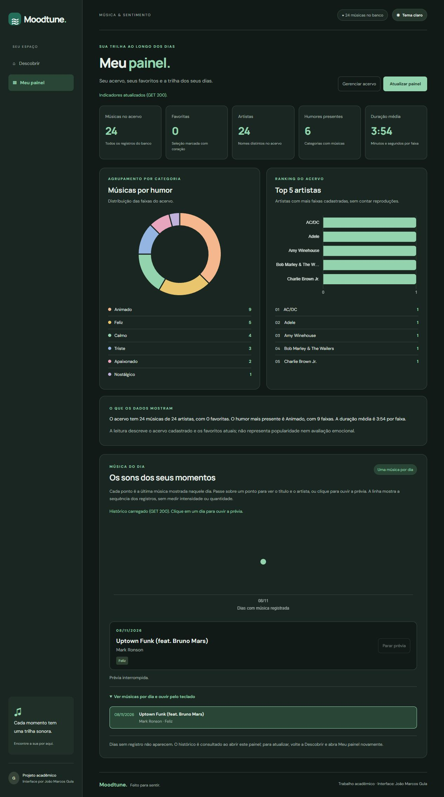
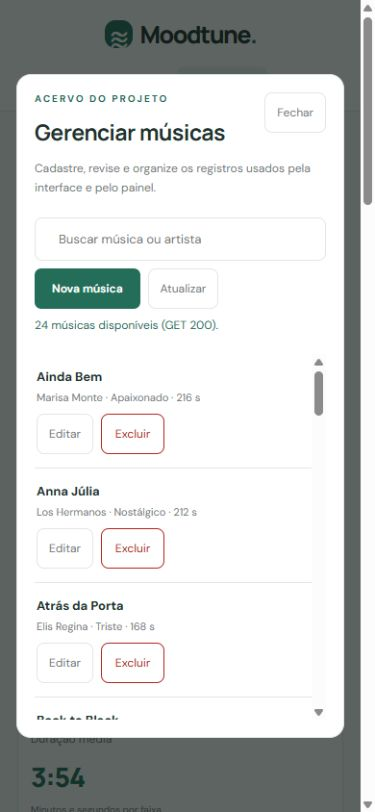
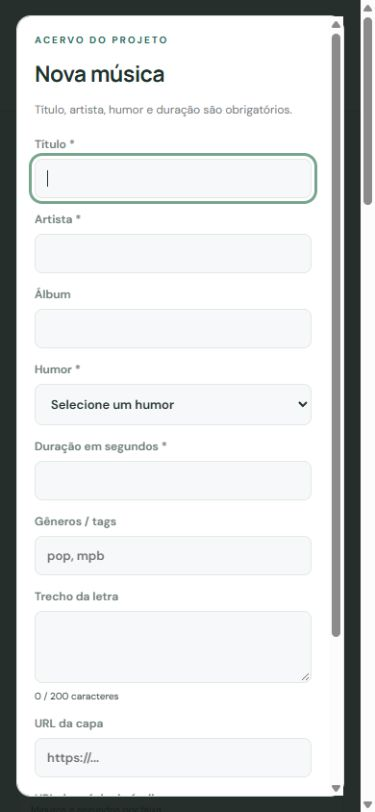

# MoodTune

Trabalho da disciplina de Banco de Dados (Engenharia de Software, UNC) — professor Luis Claudio.

O MoodTune é um site onde a pessoa escolhe **como está se sentindo** e recebe uma música com um
**trecho da letra destacado**, junto com a capa do álbum e uma prévia de 30 segundos.

## Equipe

| Integrante | Papel |
| --- | --- |
| Luiz | Dados: modelagem e banco no Docker |
| Henrique | API: requisições HTTP, coleção do Postman e importação |
| Gula | Interface: frontend, painel e gráficos |

## Tema e APIs

| API | Para quê | Exemplo |
| --- | --- | --- |
| [iTunes Search API](https://performance-partners.apple.com/search-api) | título, artista, álbum, duração, capa e prévia | `https://itunes.apple.com/search?term=Coldplay+Yellow&entity=song&country=BR&limit=1` |
| [LRCLIB](https://lrclib.net/docs) | letra, de onde sai o trecho destacado | `https://lrclib.net/api/get?track_name=Yellow&artist_name=Coldplay&duration=269` |

As duas são gratuitas, sem chave, e só recebem `GET`. Elas não têm id em comum: a ligação é feita por
**artista + título**, com a **duração** em segundos confirmando que é a mesma gravação. O humor de
cada música é decidido pelo grupo, porque nenhuma das APIs tem essa informação.

As APIs não estão no catálogo do enunciado; foram propostas pelo grupo, como o enunciado permite.

## Como rodar

Pré-requisito: Docker.

```bash
docker compose up -d
```

Abra **http://localhost:3000**.

Na primeira vez o banco está vazio, e o próprio site importa as **60 músicas pré-definidas**
(10 por humor), sem nenhum botão:

1. `PUT /musicas` cria a coleção;
2. para cada música, `GET` no iTunes e `POST` no banco (cerca de 1 minuto);
3. para cada música, `GET` na LRCLIB e `PATCH` com o trecho da letra (alguns minutos, com o site
   já funcionando).

Depois disso o site só lê e grava no banco. A lista pré-definida fica em `frontend/app.js`
(`MUSICAS_PRE_DEFINIDAS`).

```bash
docker compose ps          # os 3 serviços devem estar "running"
docker compose stop        # pausar sem perder nada
docker compose down        # parar e remover os containers (os dados continuam)
docker compose down -v     # parar e APAGAR os dados; na próxima abertura o site importa de novo
docker compose logs -f restheart
```

| Serviço | Imagem | Porta |
| --- | --- | --- |
| `mongodb` | `mongo:7` | 27017 (volume nomeado `dados-mongo`) |
| `restheart` | `softinstigate/restheart:8` | 8080 — API REST, Basic `admin` / `secret` |
| `frontend` | `nginx:alpine` | 3000 — serve a pasta `frontend/` |

Para ver os dados no MongoDB Compass: `mongodb://localhost:27017`, banco `restheart`, coleção
`musicas`.

## Estrutura

```
├── docker-compose.yml       MongoDB + RESTHeart + nginx
├── frontend/
│   ├── index.html
│   ├── app.js               requisições ao banco, importação e tela
│   ├── historico.js         registro e leitura da música do dia
│   ├── painel.js            linha do tempo e navegação
│   ├── analises.js          indicadores, gráficos e ranking
│   ├── gestao.js            formulário e confirmação de exclusão
│   └── style.css
├── postman/colecao.json     coleção exportada, com testes
├── docs/prints/             prints das requisições
└── README.md
```

## Modelo do documento

Coleção `musicas`:

```json
{
  "trackId": 1122782283,
  "titulo": "Yellow",
  "artista": "Coldplay",
  "album": "Parachutes",
  "humor": "apaixonado",
  "duracao": 269,
  "trecho": "Look at the stars, look how they shine for you",
  "tags": ["alternativo"],
  "capa": "https://.../300x300bb.jpg",
  "previa": "https://.../preview.m4a",
  "favorito": false,
  "criadoEm": "2026-10-25T19:11:59.496Z",
  "atualizadoEm": "2026-10-25T19:11:59.496Z"
}
```

* **Número:** `duracao` (segundos) · **Data:** `criadoEm`, `atualizadoEm` · **Lista embutida:** `tags`
* **Campos criados pelo grupo:** `humor`, `trecho`, `favorito`, `atualizadoEm`
* `titulo`, `artista`, `album`, `duracao`, `capa` e `previa` vêm do iTunes; `trecho` vem da LRCLIB.

**Embutido:** as `tags` ficam dentro do documento porque são poucas, mudam junto com a música e
nunca são consultadas sozinhas.

**Referenciado:** a letra completa continua na LRCLIB, e o banco guarda só o `trecho` destacado. O
`trackId` é a chave da música no iTunes: em vez de copiar o registro inteiro da API, guardamos o id
que permite voltar lá.

## Endpoints

Base `http://localhost:8080`, autenticação Basic `admin` / `secret`.

| Ação | Método e URL | Status |
| --- | --- | --- |
| Criar coleção | `PUT /musicas` | 201 (200 se já existia) |
| Inserir | `POST /musicas` | 201, id no cabeçalho `Location` |
| Listar | `GET /musicas?pagesize=100` | 200 |
| Buscar uma | `GET /musicas/{id}` | 200 / 404 |
| Filtrar por humor | `GET /musicas?filter={"humor":"feliz"}` | 200 |
| Substituir | `PUT /musicas/{id}` | 200 |
| Alterar campos | `PATCH /musicas/{id}` | 200 |
| Excluir | `DELETE /musicas/{id}` | 204 |
| Sem autenticação | qualquer uma | 401 |

No site, quem visita escolhe um humor (`GET` filtrado e sorteio de uma música), busca por título,
artista ou álbum, filtra por gênero e favorita (`PATCH`); o botão **♥ Favoritas** mostra só as
marcadas. Clicar de novo no humor escolhido, ou em **Limpar humor**, desfaz a seleção e
para a prévia. A área **Gerenciar acervo** permite cadastrar (POST), editar (PUT) e excluir
(DELETE) músicas, com validação dos campos e confirmação antes da exclusão. As mensagens de
operações concluídas ou falhas HTTP mostram o status retornado pela API.

## Coleção do Postman

`postman/colecao.json` tem 12 requisições, na ordem do fluxo: **01–02** nas APIs externas e
**03–12** no banco (CRUD completo, o 404 depois do DELETE e o 401 sem autenticação). A 04 (POST)
guarda o id do cabeçalho `Location` na variável `idMusica`, usada pelas seguintes.

```bash
npx newman run postman/colecao.json
```

Prints de cada requisição, com o status à mostra:

| Requisição | Status | Print |
| --- | --- | --- |
| iTunes | 200 | [api-itunes.png](docs/prints/api-itunes.png) |
| LRCLIB | 200 | [api-lrclib.png](docs/prints/api-lrclib.png) |
| Criar coleção | 200 | [criar-colecao-200.png](docs/prints/criar-colecao-200.png) |
| POST | 201 | [post-201.png](docs/prints/post-201.png) |
| GET lista | 200 | [get-lista-200.png](docs/prints/get-lista-200.png) |
| GET filtro | 200 | [get-filtro-200.png](docs/prints/get-filtro-200.png) |
| PUT | 200 | [put-200.png](docs/prints/put-200.png) |
| DELETE | 204 | [delete-204.png](docs/prints/delete-204.png) |
| GET depois do DELETE | 404 | [get-404.png](docs/prints/get-404.png) |
| Sem autenticação | 401 | [sem-auth-401.png](docs/prints/sem-auth-401.png) |

## Interface e painel — Gula

A interface foi finalizada em HTML, CSS e JavaScript puro, com o visual do Moodtune,
temas claro/escuro, navegação por teclado e adaptação a celular.

### Requisitos atendidos

| Requisito | Implementação |
| --- | --- |
| Listagem, busca e filtros | Descobrir: texto sem acento, humor, gênero e favoritas; botão Mostrar mais |
| Formulário de criação e edição | Gerenciar acervo: POST e PUT, campos obrigatórios, limites, duração inteira e URLs HTTP/HTTPS |
| Confirmação antes de excluir | Diálogo com título e artista, botão Cancelar e DELETE apenas após confirmação |
| Mensagens de estado | Carregamento, sucesso com status HTTP, erro de resposta/conexão e estados vazios |
| Pelo menos 4 indicadores | Total de músicas, favoritas, artistas, humores presentes e duração média |
| Gráficos de tipos diferentes | Rosca por humor, barras horizontais de artistas e linha do tempo Música do dia, com Chart.js |
| Ranking | Top 5 artistas pela quantidade de faixas cadastradas |
| Agrupamento por categoria | Quantidade de músicas em cada humor, com lista acessível dos valores |
| Atualização após alterações | POST, PUT, PATCH e DELETE atualizam Descobrir; o evento musicas-carregadas atualiza os indicadores do painel aberto |
| Conclusão e prints | Parágrafo de leitura dos dados e capturas abaixo |

### Como usar

1. Em Descobrir, escolha um humor, procure uma faixa ou filtre por gênero/favoritas.
2. Use Gerenciar acervo para cadastrar uma música, editar seus campos ou solicitar exclusão.
3. Em Meu painel, confira os cinco indicadores, a distribuição por humor e o ranking.
4. Na linha do tempo, clique em um ponto ou selecione um dia pela lista para ouvir a prévia.
5. Atualizar painel consulta novamente os indicadores e o histórico.

No formulário, título, artista, humor e duração são obrigatórios. Duração deve ser
inteira, de 1 a 86400 segundos. O trecho tem limite de 200 caracteres, e capa/prévia
aceitam somente URLs HTTP/HTTPS sem credenciais. Tags repetidas são removidas.
A edição preserva os metadados existentes da música; os campos internos do MongoDB
não são enviados no corpo do PUT. O contador do trecho acompanha a digitação.

Os indicadores usam o acervo inteiro, independentemente dos filtros de Descobrir.
A função listarMusicas percorre páginas de 100 registros com ordenação por _id,
para que os indicadores não sejam cortados na primeira página. Nomes de artista
são agrupados ignorando maiúsculas e espaços extras. Empates no ranking usam ordem
alfabética. Duração média considera as durações válidas do acervo.

O histórico continua usando exclusivamente listarHistorico(), sem alterar historico.js.
Cada ponto representa o registro daquele dia, sem inventar dias intermediários ou
somar músicas. A altura dos pontos não é uma medida. Datas são formatadas separando
a string AAAA-MM-DD. Um único Audio é reutilizado para as prévias do painel, e a
reprodução é interrompida ao trocar de música ou sair. A lista oferece a mesma
seleção pelo teclado. Registros já existentes no histórico permanecem após excluir
uma música do acervo, pois guardam os dados daquele dia.

### Leitura dos dados

Na verificação de 08/11/2026, o banco local tinha **24 músicas, de 24 artistas**, nos
**6 humores**, com duração média de **3 minutos e 54 segundos**. O humor Animado
concentrava **9 faixas (37,5% do acervo)**, enquanto Nostálgico tinha uma faixa; isso
mostra maior presença de músicas animadas nessa seleção. Como cada artista tinha
uma faixa, o ranking estava empatado e foi organizado alfabeticamente. Não havia
favoritas marcadas naquele momento. Esses números descrevem o acervo e as escolhas
salvas; não medem reproduções, popularidade ou a emoção de quem usa o sistema.
A conclusão exibida no painel é calculada novamente conforme os dados mudam.

### Verificação realizada

- Docker local: MongoDB, RESTHeart e nginx, com acesso por http://localhost:3000.
- Fluxo real: criação POST 201, edição PUT 200, favorito PATCH 200 e exclusão DELETE 204.
- Cancelar a exclusão preservou o registro; o formulário bloqueou campos obrigatórios
  vazios e URL inválida, manteve os dados após falha de conexão e permitiu nova tentativa.
- Os indicadores acompanharam a inclusão e a remoção do registro temporário, voltando
  de 25 para as 24 músicas originais. O registro de teste foi removido ao terminar.
- O serviço RESTHeart foi pausado temporariamente para validar os erros de conexão
  e reiniciado após o teste. Dados reais não foram apagados.
- Tema claro/escuro, teclado, mensagens, histórico com áudio real e celular de 390 px,
  sem rolagem horizontal no painel ou no formulário.
- Testes de lógica: cálculos, empates, acervo vazio, validação, URLs, tags, paginação
  com 101 músicas e preservação de metadados no PUT. Nenhum erro não tratado nos novos módulos.

### Capturas da interface

Painel no computador:



Painel no celular:


Gerenciamento e formulário no celular:





### Organização do código da interface

- frontend/index.html: estrutura das telas, indicadores, gráficos e diálogos.
- frontend/style.css: visual, temas e responsividade.
- frontend/app.js: foram adicionados os helpers de PUT/DELETE e a leitura paginada;
  o contador distingue erro de conexão de um acervo vazio. A importação e as funções
  globais existentes foram preservadas.
- frontend/painel.js: mantém a linha do tempo e passa a atender ao botão Atualizar painel.
- frontend/analises.js: cálculos, cinco indicadores, agrupamento, ranking e gráficos.
- frontend/gestao.js: formulário, validação, operações e confirmação de exclusão.
- frontend/historico.js: preservado nesta finalização.

A implementação, revisão e validação desta parte da interface tiveram apoio do Codex.
